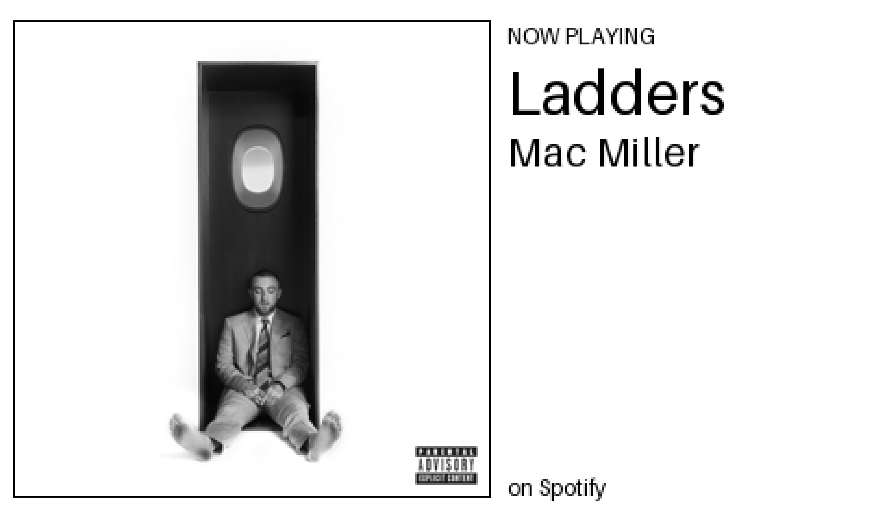

# Pi Now Playing 🎵

A small e-paper display on my desk that shows whatever is playing on my Bose speaker – from **any** source (Spotify, AirPlay, radio) – with the album cover, track and artist.

Built on a Raspberry Pi 3 Model B that was sitting in a drawer, as my first "real world" coding project.



<!-- TODO: add a photo of the finished display on the desk: images/desk-photo.jpg -->

## Why I built it

I wanted a fun, small project that would make me learn by doing: hardware, Python, APIs, and running something that works on its own without me babysitting it. It was inspired by [this Spotify desk widget](https://medium.com/@kikeonline/spotify-desk-widget-with-a-raspberry-pi-and-e-paper-display-d94ebf47a900), but I took a different route:

- **Any source, not just Spotify.** I play to my speaker from different apps, so the display asks the *speaker* what it's playing rather than asking Spotify.
- **One device, no Home Assistant.** The original used a second server; mine runs everything on the Pi.

## How it works

```
Phone ──(AirPlay / Spotify)──▶ Bose speaker
                                    ▲
                                    │ "what are you playing?"  (every 15 s)
                                    │
Raspberry Pi ── sources.py ─────────┘
     │            └─ if it's a Spotify track, also asks the Spotify API for cleaner details + cover
     │
     ├─ display_preview.py  draws a 480×280 greyscale image with Pillow
     └─ only redraws when the song changes ──▶ 3.7" e-paper screen
```

A few decisions worth calling out:

| Decision | Why |
|---|---|
| Ask the speaker, then enrich from Spotify | The speaker knows about every source; Spotify has the best metadata and artwork |
| Only redraw when the song changes | E-paper is slow and flashes on refresh – and it saves hammering the APIs |
| Full-refresh 4-grey mode | The fast black & white mode left "ghosts" of the previous cover |
| Same script runs on Mac and Pi | On the Mac it saves a preview image, so I could design the screen before the hardware arrived |
| Runs as a `systemd` service | Plug it in and it just works – no laptop needed |

## Hardware

- Raspberry Pi 3 Model B
- Waveshare 3.7" e-Paper HAT (480×280, 4 greys)
- microSD card, official Pi power supply
- Bose Portable Smart Speaker (any Bose speaker that works with the Bose app *should* work – see note below)

## Files

| File | What it does |
|---|---|
| `display_preview.py` | Main program: checks what's playing, draws the screen, sends it to the e-paper (or a preview on a Mac) |
| `sources.py` | Asks the Bose speaker what's playing, tidies up the text, and adds Spotify details when they match |
| `test_screen.py` | Quick "hello" test for the e-paper screen |
| `now_playing.py` / `bose_now_playing.py` | Early experiments: print what's playing from Spotify / from the Bose |
| `nowplaying.service` | Makes the display start automatically when the Pi boots |
| `.env.example` | Template for your own Spotify and Bose login details |

## Setting it up yourself

1. **Spotify:** create an app at the [Spotify Developer Dashboard](https://developer.spotify.com/dashboard) with redirect URI `http://127.0.0.1:8888/callback`. (Spotify requires the account owner to have Premium for developer apps.)
2. **Install:**
   ```bash
   python3 -m venv venv
   source venv/bin/activate
   pip install -r requirements.txt
   cp .env.example .env   # then fill in your own details
   ```
3. **Screen driver (on the Pi):** enable SPI (`sudo raspi-config nonint do_spi 0`), then:
   ```bash
   pip install spidev gpiozero lgpio
   mkdir -p waveshare_epd
   wget -P waveshare_epd https://raw.githubusercontent.com/waveshareteam/e-Paper/master/RaspberryPi_JetsonNano/python/lib/waveshare_epd/epd3in7.py
   wget -P waveshare_epd https://raw.githubusercontent.com/waveshareteam/e-Paper/master/RaspberryPi_JetsonNano/python/lib/waveshare_epd/epdconfig.py
   touch waveshare_epd/__init__.py
   ```
4. **Run it:** `python3 display_preview.py` – or install `nowplaying.service` to start it on boot.

> **Note on the Bose connection:** this uses [pybose](https://github.com/cavefire/pybose), a community library – not an official Bose API – so a Bose firmware update could break it. It also needs your Bose account login, even though it talks to the speaker over your home network.

## What I learned

- Reading error messages properly (bottom-up, find the line in *your* file) saves more time than anything else.
- Real-world integrations are messy: an unofficial library with a missing dependency and a bug that hung on disconnect; Spotify arriving over AirPlay so the speaker didn't know it was Spotify; radio stations squashing three fields into two.
- Prototype without the hardware. Building a "pretend screen" first meant the hardware step was mostly plugging in.
- How to read library documentation – and that the docs show a *menu* of options, not a line to paste.

I built this with [Claude](https://claude.ai) as a coach – early on it wrote most of the code while I learned to read it; by the end I was writing the changes myself and asking for reviews and hints instead.

## Credits

- Inspiration: [Spotify desk widget](https://medium.com/@kikeonline/spotify-desk-widget-with-a-raspberry-pi-and-e-paper-display-d94ebf47a900) by kikeonline
- [pybose](https://github.com/cavefire/pybose) for talking to Bose speakers
- [Waveshare e-Paper](https://github.com/waveshareteam/e-Paper) drivers
- [spotipy](https://spotipy.readthedocs.io/) and [Pillow](https://pillow.readthedocs.io/)

## License

MIT – see [LICENSE](LICENSE).
# pi-now-playing
